# RTS WS2026/27 – Task 2: Remote-Controlling I2C Peripherals over IEEE 1722

Project for the course *Real-Time Systems* (Heilbronn University).

**Goal:** Two different I2C peripherals attached to a board are controlled remotely from another computer over Ethernet. The I2C transactions are carried as IEEE 1722 ACF messages (`ACF_I2C`, IEEE 1722-2025 §9.4.16) using the [Open1722](https://github.com/COVESA/Open1722) library. Open1722 supports this format, but it has never been used in an actual application.

| Document | Content |
|---|---|
| [docs/PROJECT_PLAN.md](docs/PROJECT_PLAN.md) | Project plan: work packages, order, dependencies, risks |
| [docs/HARDWARE.md](docs/HARDWARE.md) | Required hardware |
| System overview | see below |

---

## System Overview

```mermaid
flowchart LR
    subgraph PC["Host / Controller side (laptop, Linux)"]
        direction TB
        APP["Demo application<br/>e.g. read temperature,<br/>print text on OLED"]
        DEV["Device logic<br/>(registers, conversion)<br/>sensor + OLED"]
        API["Remote I2C API<br/>i2c_remote_write_read(addr, …)"]
        AGT["Controller / Target Agent<br/>transaction → CR1…CR8<br/>match responses via transaction_num<br/>timeout & error handling"]
        LIB1["Open1722<br/>I2C.h · Ntscf.h · sockets"]
        APP --> DEV --> API --> AGT --> LIB1
    end

    subgraph BRD["Target board (Raspberry Pi or STM32 Nucleo)"]
        direction TB
        LIB2["Open1722<br/>I2C.h · Ntscf.h · sockets"]
        TC["Target Controller<br/>CRx → bus event (S, byte, ACK, P)<br/>bus result → TR1…TR5"]
        HWI["I2C hardware / driver"]
        LIB2 --> TC --> HWI
    end

    LIB1 == "Stream A: requests (CR1–CR8)<br/>NTSCF + ACF_I2C · Ethernet 0x22F0 (alt. UDP)" ==> LIB2
    LIB2 == "Stream B: responses (TR1–TR5)" ==> LIB1

    HWI -- "SDA / SCL" --- S1["Device 1: sensor<br/>(e.g. 0x48)"]
    HWI -- "SDA / SCL" --- S2["Device 2: OLED display<br/>(0x3C)"]

    WS["Wireshark<br/>(verification on the network)"] -.-> LIB1
    LA["Logic analyzer<br/>(verification on the bus)"] -.-> HWI

    classDef existing fill:#e8e8e8,stroke:#888,color:#333
    classDef new fill:#d6ecff,stroke:#1f6feb,color:#000,stroke-width:2px
    classDef hw fill:#fff4d6,stroke:#b58900,color:#000
    class LIB1,LIB2 existing
    class APP,DEV,API,AGT,TC new
    class S1,S2,HWI hw
```



**Legend:** grey = already exists in Open1722 · blue = developed by us · yellow = hardware

### In words

1. The application on the laptop wants, for example, to "read 2 bytes from register 0x00 of device 0x48".
2. The **Controller Agent** breaks this down into the I2C bus events defined in Table 27 of the spec (START + address → register byte → repeated START → read → NACK + STOP). It sends each event as an `ACF_I2C` message inside an NTSCF frame over Ethernet (stream A).
3. The **Target Controller** on the board replays each event on the real I2C bus. It sends the result (ACK/NACK/data, Table 28) back with the same `transaction_num` (stream B).
4. To the application this looks like a local I2C access, just over the network.

An AVTP stream is unidirectional, so there are **two streams**. Each side acts as both Talker and Listener.

---

## Repository Structure (planned)

```
├── README.md
├── docs/                project plan, hardware, design notes, measurement results
├── Open1722/            submodul (fork)
├── src/
│   ├── controller/      remote I2C API + Controller Agent (laptop)
│   ├── target/          Target Controller (board)
│   └── demo/            demo applications for the two devices
├── test/                unit and loopback tests
└── AI_USAGE.md          disclosure of AI tool usage (required by the course)
```
