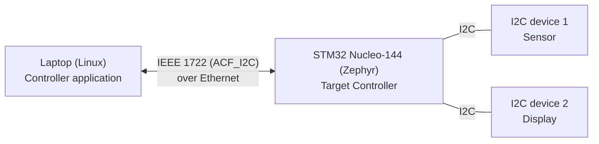
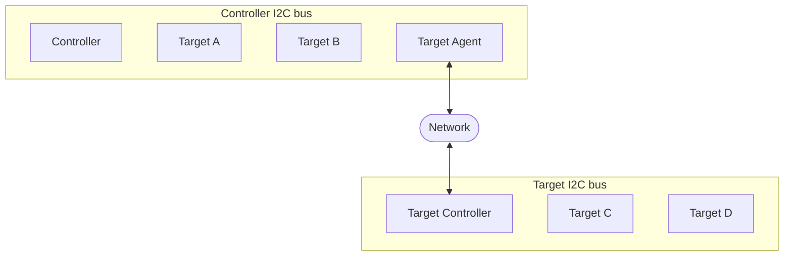
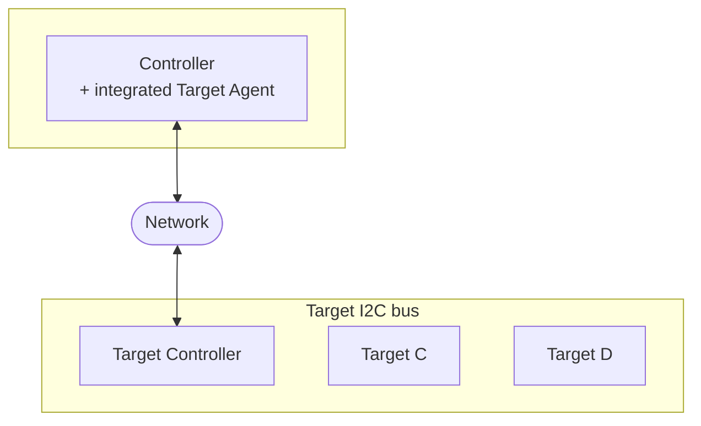

# RTS WS2026/27 – Task 2: Remote-Controlling I2C Peripherals over IEEE 1722

Project for the course *Real-Time Systems* (Heilbronn University).

**Goal:** Two different I2C peripherals attached to a board are controlled remotely from another computer over Ethernet. The I2C transactions are carried as IEEE 1722 ACF messages (`ACF_I2C`, IEEE 1722-2025 §9.4.16) using the [Open1722](https://github.com/COVESA/Open1722) library. Open1722 supports this format, but it has never been used in an actual application.

| Document | Content |
|---|---|
| [doc/PROJECT_PLAN.md](doc/PROJECT_PLAN.md) | Project plan: work packages, order, dependencies |
| [doc/HARDWARE.md](doc/HARDWARE.md) | Required hardware and availability |
| System overview | see below |

---

## System Overview



An application on the laptop wants to access an I2C device, for example to read a sensor value or to write text to a display. Instead of using a local I2C bus, every I2C transaction is packed into IEEE 1722 `ACF_I2C` messages and sent over Ethernet to the Nucleo board. The board executes the transaction on its I2C bus and sends the result (ACK/NACK, read data) back. To the application this looks like a local I2C access.

### Background: I2C over a network in IEEE 1722

IEEE 1722-2025 (§9.4.16.1) describes two arrangements for the I2C message.

**(a) Interconnecting two I2C buses** (based on IEEE 1722-2025, Figure 87)



A *Target Agent* on the controller's I2C bus forwards transactions addressed to remote devices over the network to a *Target Controller*, which replays them on the remote I2C bus. Neither the Controller nor the remote Targets notice the network in between.

**(b) Controller with integrated Target Agent** (based on IEEE 1722-2025, Figure 88)



Here the Controller is connected directly to the network and generates the I2C request messages itself. There is no I2C bus on the controller side.

Our first planned setup corresponds to arrangement (b): the laptop is the Controller with integrated Target Agent, the Nucleo board is the Target Controller, and the sensor and display are Targets C and D.

*Diagrams are based on IEEE Std 1722-2025, Figures 87 and 88.*

---

## Getting Started

> **TODO:** Build and run instructions will be added once the first version of the code is available.

---

## Repository Structure (planned)

```
├── README.md
├── doc/                 project plan, hardware, design notes, measurement results
├── Open1722/            submodule (fork)
├── src/
│   ├── controller/      remote I2C API + Controller Agent (laptop)
│   ├── target/          Target Controller (board)
│   └── demo/            demo applications for the two devices
├── test/                unit and loopback tests
└── AI_USAGE.md          
```

---

## Branches

- **`main`** – stable state. `main` should always build.
- **`develop`** – the latest state of our work is usually found here. We cannot guarantee that `develop` compiles at all times, so if you run into build problems, please use `main`.
