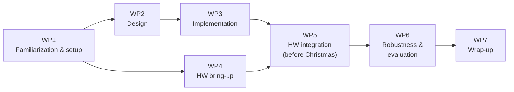

# Project Plan – Version 0.1

## 1. Goal and Definition of Done

**Goal:** Two different I2C peripherals attached to a board are controlled remotely from another computer via IEEE 1722 (`ACF_I2C`, IEEE 1722-2025 §9.4.16).

**The project is done when:**

- a working demo carries real I2C transactions (read **and** write) over IEEE 1722 to **two different** I2C devices;
- the traffic has been verified on the network (Wireshark);
- the code can be built from the repository at any time (Linux), is documented and has tests;
- the chosen operating mode, any deviations from the spec and our design decisions are documented and justified.

## 2. Starting Point: What Exists, What Is Missing

| Building block | Status | Source |
|---|---|---|
| `ACF_I2C` / `ACF_I2C_BRIEF` codec (get/set fields, validation) | exists | `include/avtp/acf/I2C.h`, `I2CBrief.h` |
| Unit tests for the codec | exists (10 tests) | `unit/test-i2c.c` |
| NTSCF/TSCF headers, Ethernet and UDP sockets | exists | `include/avtp/acf/Ntscf.h`, `examples/common/` |
| GBB/ABB codec (alternative recommended by the spec) | exists | `Gbb.h`, `Abb.h` |
| **Protocol logic** (which message when, request/response matching, timeouts, errors) | **missing** | core work |
| **Controller side** (transaction → request sequence, API for applications) | **missing** | core work |
| **Target side** (execute requests on a real I2C bus, send responses) | **missing** | core work |
| Example application / demo on real hardware | **missing** | core work |
| Build integration, CI, documentation for the I2C example | **missing** | |

**Conclusion:** The data format exists. We build the **application and protocol logic on top of it** and bring it up on real hardware.

## 3. Work Packages

### WP0 – Organization

- Repository, project plan, system overview, hardware list (done)

### WP1 – Familiarization and Setup

- Study the relevant parts of IEEE 1722 and the Open1722 code base
- Set up build environments (Linux, Zephyr) and run the existing examples

### WP2 – Design

- Define the message flow and the behavior of both sides
- Define the API for the application
- Document the design in `doc/DESIGN.md`

### WP3 – Implementation

- Controller side and target side
- First tests without real hardware (simulated I2C device, loopback)

### WP4 – Hardware Bring-up

- Nucleo board with Zephyr and network connection
- Local access to both I2C devices

### WP5 – Hardware Integration

- End-to-end demo with both I2C devices
- Verification of the network traffic with Wireshark

### WP6 – Robustness and Evaluation

- Error handling
- Latency measurements
- Optional extensions

### WP7 – Wrap-up

- Documentation and CI
- Final report, presentation and live demo
- Drect PR to Open-1722

## 4. Timeline

Our main target is to **finish the hardware integration (WP5) before the Christmas break**. The remaining time until the end of the semester is reserved for WP6 and WP7.

## 5. Dependencies

WP3 (software) and WP4 (hardware) can run in parallel. Testing WP3 against a simulated I2C device first keeps the software work from being blocked by the hardware.

## 6. Questions for the Supervisor

1. Is the `ACF_I2C` format explicitly required, or is GBB/ABB (Annex M) also acceptable or even desired as a comparison?
2. Is the integrated agent (Fig. 88) sufficient, or is the transparent bus interconnect with clock stretching (Fig. 87) expected?
