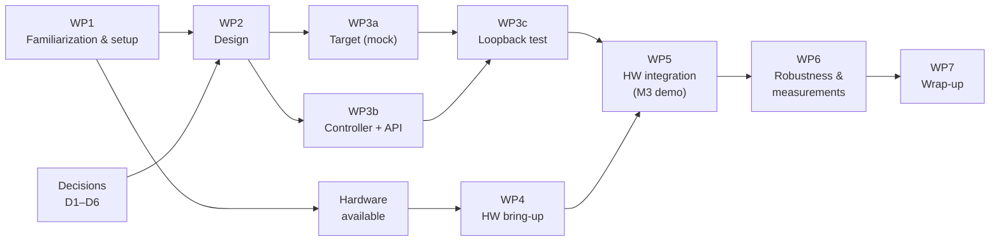

# Project Plan – Version 0.1 

## 1. Goal and Definition of Done

**Goal:** Two different I2C peripherals attached to a board are controlled remotely from another computer via IEEE 1722 (`ACF_I2C`, IEEE 1722-2025 §9.4.16).

**The project is done when:**

- a working demo carries real I2C transactions (read **and** write) over IEEE 1722 to **two different** I2C devices;
- the traffic has been verified both on the network (Wireshark);
- the code can be built from the repository at any time (Linux), is documented and has tests;
- the chosen operating mode, any deviations from the spec and our design decisions are documented and justified;

## 2. Starting Point: What Exists, What Is Missing

| Building block | Status | Source |
|---|---|---|
| `ACF_I2C` / `ACF_I2C_BRIEF` codec (get/set fields, validation) | exists | `include/avtp/acf/I2C.h`, `I2CBrief.h`  |
| Unit tests for the codec | exists (10 tests) | `unit/test-i2c.c` |
| NTSCF/TSCF headers, Ethernet and UDP sockets | exists | `include/avtp/acf/Ntscf.h`, `examples/common/` |
| GBB/ABB codec (alternative recommended by the spec) | exists | `Gbb.h`, `Abb.h` |
| **Protocol logic** (which message when, request/response matching, timeouts, errors) | **missing** | core work |
| **Controller side** (transaction → request sequence, API for applications) | **missing** | core work |
| **Target side** (execute requests on a real I2C bus, send responses) | **missing** | core work |
| Example application / demo on real hardware | **missing** | core work |
| Build integration, CI, documentation for the I2C example | **missing** | |

**Conclusion:** The data format exists. We build the **application and protocol logic on top of it** and bring it up on real hardware.

## 3. Work Packages

### WP0 – Organization (until Oct 20)

- Create repository, invite supervisors (done)
- Project plan, system diagram, hardware list (this document)
- Assign roles within the team

### WP1 – Familiarization and Setup (CW 43–44)

- Read IEEE 1722: §4.1–4.3, §4.7, §9.1–9.4.1, **§9.4.16/17 (in depth)**, §9.4.14/15 + Annex M (skim)
- Build Open1722 locally and run the unit tests (`cmake`, `libcmocka-dev`)
- Run the `acf-can` example with a virtual CAN interface (`vcan`) and capture it in Wireshark, as a reference for our own example
- Build Wireshark from source to get the full 1722 dissector (recommended in the course slides)
- Clarify open questions D1/D3 with the supervisor
- Order or borrow hardware

### WP2 – Design (CW 44–45)

- Derive **message sequences** for all required transaction types from Fig. 90: write, write with target NACK, read, write + repeated START + read
- **State machines** for Controller Agent and Target Controller (including exception codes, Table 29)
- Stream concept: 2 streams, stream IDs, MAC/UDP addressing
- Define the application API, e.g. `i2c_remote_write()`, `i2c_remote_read()`, `i2c_remote_write_read()`
- Timeout and error strategy (NACK, timeout, lost packets)
- Deliverable: `docs/DESIGN.md`

### WP3 – Implementation without Hardware (CW 45–47)

Goal: development and testing can start **before the hardware is up and running**.

- WP3a: **Target Controller** with a *simulated I2C device* (mock: register array in memory)
- WP3b: **Controller Agent** + remote I2C API
- WP3c: **Loopback test**: both sides on one machine (veth pair or UDP on localhost), automated, later part of CI
- WP3d (optional, in parallel): PR to Open1722 adding constants for `i2c_code` and `exception_code`

### WP4 – Hardware Bring-up (CW 45–47, in parallel with WP3)

- Set up the board (OS or Zephyr toolchain) and the network between laptop and board
- Access both I2C devices locally on the board (`i2cdetect` or an I2C scanner, simple local read/write tests)
- Investigate and prototype low-level access at the bus-event level (→ **risk R1**)

### WP5 – Integration on Real Hardware (CW 48–50)

- Replace the mock from WP3a with real I2C access
- Device logic on the laptop: read the sensor (e.g. °C), write text to the OLED
- End-to-end demo with **both** devices
- Verification: Wireshark (network) and logic analyzer (bus) side by side

**→ Milestone M3: demo running (target: before Christmas)**

### WP6 – Robustness and Measurements (CW 50–02)

- Error cases: NACK (wrong address), bus timeout, sequence errors → exception codes
- Latency measurement per transaction (real-time focus of the course) and analysis of influencing factors
- *Optional:* lost message handling (§9.4.16.13)
- *Optional:* comparison of `ACF_I2C` vs. `ACF_I2C_BRIEF` vs. ABB (packet count, latency)

### WP7 – Wrap-up (CW 02–04)

- Finalize README and build instructions, CI (build + unit + loopback tests)
- Final report including AI usage disclosure
- Prepare presentation and live demo

## 4. Dependencies

**Critical path:** WP1 → decisions → WP2 → WP3 → WP5. Hardware bring-up (WP4) runs in parallel and must not block WP5. This is why WP3 is first developed against a simulated device.

## 5. Questions for the Supervisor

1. Is the `ACF_I2C` format explicitly required, or is GBB/ABB (Annex M) also acceptable or even desired as a comparison?
2. Is the integrated agent (Fig. 88) sufficient, or is the transparent bus interconnect with clock stretching (Fig. 87) expected?
